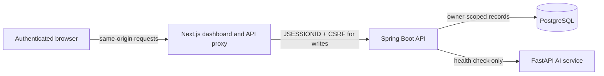

# Architecture Overview

SentinelAI is a three-service web application backed by PostgreSQL. It monitors actions performed in its own authenticated sample workspace; it does not collect host or third-party application activity.

## Frontend

- Next.js App Router dashboard with registration and sign-in.
- A server-side route handler proxies browser `/api/*` requests to runtime-configured `BACKEND_URL`; only the session cookie and CSRF header are forwarded.
- Workspace operations call authenticated APIs. The browser does not submit trusted event records or fabricate a timer-driven event stream.
- Events, alerts, incidents, and dashboard statistics are loaded from the backend for the signed-in account.

## Backend

- Spring Boot 3, Java 21, Spring Data JPA, and PostgreSQL.
- BCrypt password hashes; servlet-backed sessions with HttpOnly, SameSite Strict cookies; session-bound CSRF tokens on state-changing operations.
- Documents and security records are queried by authenticated account owner. Workspace actions create server-side activity records.
- Deterministic rules evaluate failed/successful sign-ins, denied resource access, a denied privileged operation, and repeated exports. Matching alerts and incidents are persisted alongside event records.
- A scheduled retention job removes events and linked alerts/incidents older than the configured number of days (30 by default).

## AI service

- FastAPI currently exposes only `/health`.
- The backend checks service health and reports it separately from inference. Events use `aiAnalysisStatus: NOT_CONFIGURED`; no model is invoked and no anomaly result is fabricated.

## Storage and deployment

- PostgreSQL is the only application persistence provider.
- Docker Compose persists local data in a named PostgreSQL volume.
- The Render Blueprint links managed PostgreSQL and deploys the AI, backend, and frontend Docker services. Hosted file storage is not used. Render free Postgres is temporary; see [10_DEPLOYMENT.md](./10_DEPLOYMENT.md).

## Operational limitations

HTTP sessions and login-failure throttling are in-memory. Run one backend instance for this demo; restarts clear sessions and throttle state. Signup-abuse controls, distributed coordination, production migrations, backup tooling, and a full security-product threat model are not implemented.
