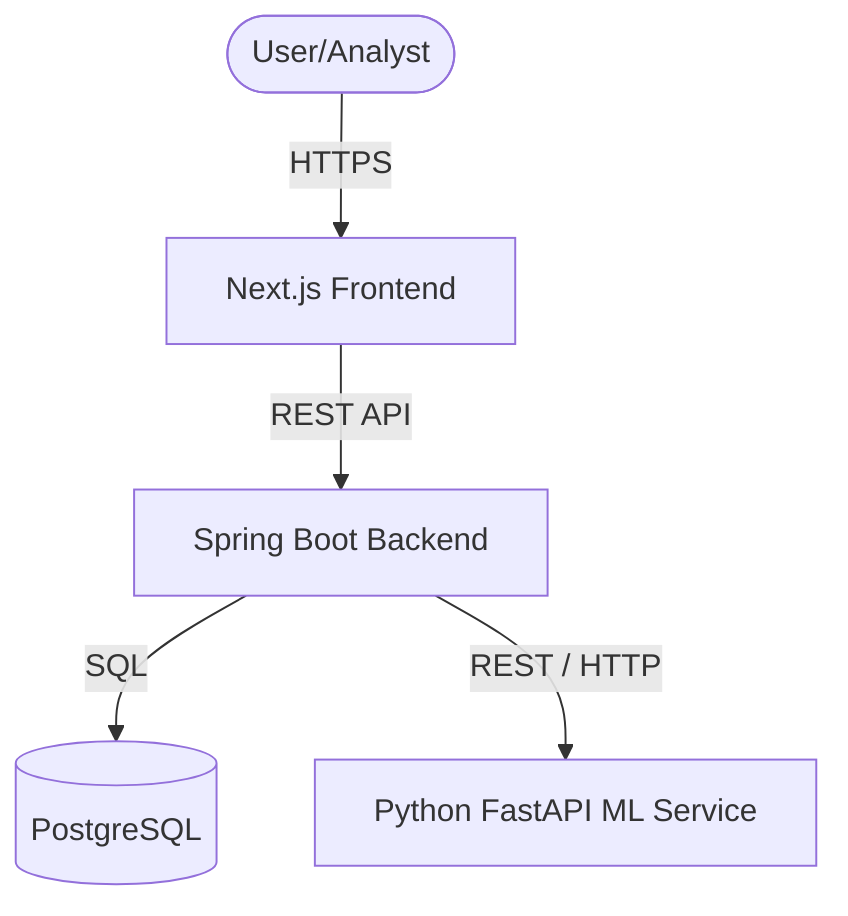
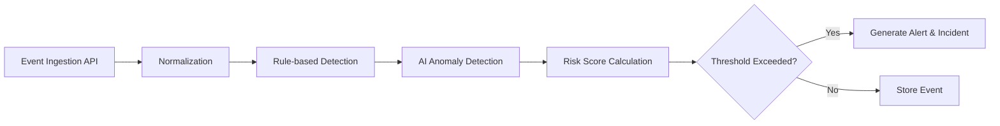

# Architecture Overview

## High-Level Architecture

The SentinelAI platform follows a modular, microservice-inspired architecture separating the core business logic from machine learning workloads, while providing a modern frontend interface.

## Frontend Architecture
- **Framework:** Next.js with App Router / Pages (based on current standard).
- **Language:** TypeScript.
- **Styling:** Tailwind CSS + shadcn/ui.
- **Role:** Renders the dark-themed analyst console, communicates via REST to the Spring Boot backend.

## Backend Architecture
- **Framework:** Spring Boot (Java).
- **Role:** Handles authentication, business logic, event ingestion routing, rule-based detection, and coordination with the AI service.
- **Layers:** 
  - Controllers (REST endpoints)
  - Services (Business logic)
  - Repositories (Data access)

## AI Service Architecture
- **Framework:** FastAPI (Python).
- **Role:** Exposes endpoints for real-time anomaly detection scoring and model training/management.
- **Core ML:** scikit-learn (Isolation Forest), Pandas.

## Database Conceptual Relationship
- **Engine:** PostgreSQL.
- **Purpose:** Centralized storage for structured data (Users, Events, Alerts, Incidents).
- (Refer to `03_DATABASE.md` for entities).

## Event Processing Flow

## Deployment Architecture
- **Local Development:** Managed via `docker-compose.yml` to orchestrate Postgres, Backend, AI Service, and Frontend locally.
- **Cloud (Future):** Microsoft Azure (Primary target), leveraging containerized services.
