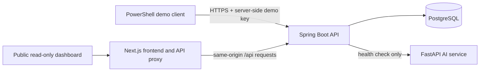

# Architecture Overview

SentinelAI is currently a three-service, synthetic-data demo backed by PostgreSQL:

## Frontend

- Next.js App Router dashboard.
- A server-side route handler proxies browser `/api/*` requests to the runtime-configured `BACKEND_URL`. The backend address is not embedded in public browser configuration.
- Dashboard reads persisted events, alerts, incidents, and statistics. It polls for updates. The separately labelled browser demo stream is localStorage-only and is not sent to the backend.
- The public dashboard has no user authentication and must display only synthetic data.

## Backend

- Spring Boot 3, Java 21, Spring Data JPA, and PostgreSQL.
- `POST /api/v1/events` requires `X-Demo-Ingestion-Key`, validates synthetic-only payloads, assigns the UUID and timestamp, applies deterministic event-type rules, and commits event/alert/incident records transactionally.
- Read APIs are public. Incident lifecycle changes and the synthetic-data reset require the same shared server-side demo key.
- This is a single-instance demo implementation; no distributed event-threshold coordination, account isolation, rate limiting, or database migrations are implemented.

## AI service

- FastAPI currently exposes only `/health`.
- The backend checks health and reports availability separately from inference. Event records use `aiAnalysisStatus: NOT_CONFIGURED`; no model is invoked and no anomaly result is fabricated.

## Storage and deployment

- PostgreSQL is the only implemented application storage provider.
- Docker Compose persists local data in a named PostgreSQL volume.
- The Render Blueprint links to managed PostgreSQL and deploys the three Docker services. Hosted file storage is not used. Render free web-service filesystems are ephemeral, and the free PostgreSQL plan expires; details are in [10_DEPLOYMENT.md](./10_DEPLOYMENT.md).
